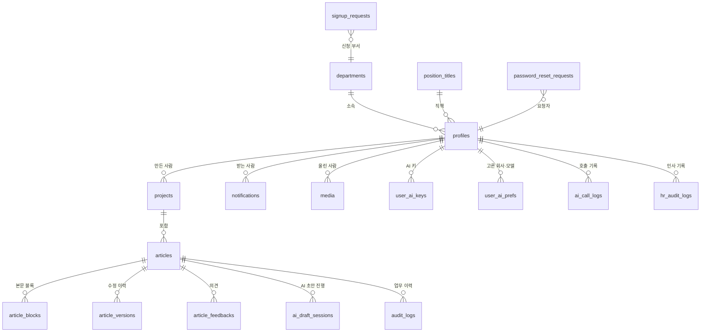

# 05. ERD (데이터 관계도)

저장소 코드가 사용하는 표 19개입니다. 아래 그림은 핵심 관계를 줄인 것입니다(GitHub·Notion 등 Mermaid 지원 화면에서 그림으로 보입니다).
※ 표 생성 파일이 저장소에 있는 것은 8개뿐이고 나머지는 저장소 밖에서 만들어졌습니다. `09_DB_스크립트.md` 참고.

## 표 설명
| 표 | 하는 일 | 영역 |
|---|---|---|
| profiles | 사용자(이름·이메일·역할·부서·직책) | 사람과 조직 |
| departments | 부서 | 사람과 조직 |
| position_titles | 직책 | 사람과 조직 |
| signup_requests | 가입 신청 | 사람과 조직 |
| password_reset_requests | 비밀번호 분실 신고 | 사람과 조직 |
| hr_audit_logs | 인사·권한 변경 기록 | 사람과 조직 |
| projects | 프로젝트(기사 묶음) | 기사와 기록 |
| articles | 기사 | 기사와 기록 |
| article_blocks | 본문 블록(글·사진) | 기사와 기록 |
| media | 사진·영상 보관함 | 기사와 기록 |
| article_versions | 수정할 때마다 저장되는 이력 | 기사와 기록 |
| article_feedbacks | 문장에 남긴 의견 | 기사와 기록 |
| ai_draft_sessions | AI 질문형 초안 진행 상태 | 기사와 기록 |
| notifications | 알림 | 기사와 기록 |
| audit_logs | 기사 업무 이력 | 기사와 기록 |
| user_ai_keys | 사용자별 AI 키(암호화) | AI |
| user_ai_prefs | 사용자가 고른 회사·모델 | AI |
| ai_system_settings | AI 전체 설정 | AI |
| ai_call_logs | AI 호출 기록(기능·회사·모델·응답 시간·글자 수) | AI |

보안 규칙: 모든 표에 행 단위 접근 규칙(RLS)을 적용하며, 기사 접근은 `can_access_article` 함수로 판단합니다.
