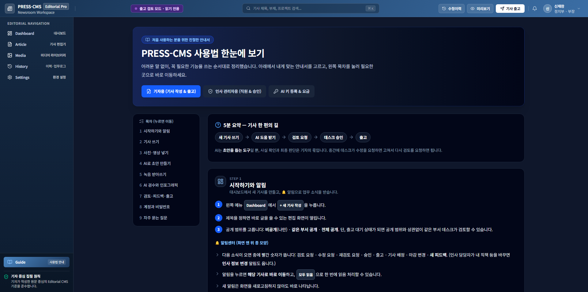

# 11. 사용자 매뉴얼

프로그램 안 왼쪽 메뉴 **사용법**에 같은 내용이 있습니다(역할별: 기자용 / 인사 관리자용 / AI 키 등록·요금).
시연 주소: https://a-team-press-cms.onrender.com/#/dashboard
저장소 주소: https://github.com/INTP-ENFJ/A-TEAM

## A. 기자용
### 5분 요약 — 기사 한 편의 길
1. 대시보드에서 **+ 새 기사 작성** → 제목을 정하면 편집 화면이 열립니다.
2. 공개 범위를 고릅니다(나만 / 같은 부서 공개). 출고 대기가 되면 같은 부서 부장이 검토할 수 있습니다.
3. 본문을 씁니다. 1초쯤 뒤 자동 저장되고, 실패하면 5초 뒤 다시 시도합니다.
4. 사진은 위쪽 미디어 탭에서 끌어다 놓거나 **기사에 넣기**를 누릅니다.
5. AI 도움이 필요하면 아래 B~C를 봅니다.
6. 다 썼으면 **검토 요청**. 수정 요청을 받으면 고친 뒤 **재검토 요청**.
7. 부장이 승인하면 출고 대기, 출고 창에서 채널을 확인하고 출고합니다.

### 편집 화면에서 쓸 수 있는 것
- 글자 수: 왼쪽 아래 “기사 원고 분량”
- TXT 가져오기: 메모장 글을 문단별로 넣기
- 내보내기: 워드(.docx, 사진 포함) 또는 텍스트
- 되돌리기: 왼쪽 메뉴 이력 → 이전 버전 복원
- 알림: 화면 위 종 모양. 누르면 해당 기사로 이동

### 사진 다루기
- 본문의 사진은 그대로 끌어서 옮깁니다(놓을 수 있는 자리는 점선·파란 선).
- 마우스를 올리면 나타나는 버튼: 자르기·확대, 일부 가리기(흐리게/모자이크), 캡션·크레딧 입력
- 미디어 메뉴: 사진 올리기(여러 장), AI 이미지(설명글로 그림 만들기, “[AI 생성 이미지]” 자동 표기)

## B. AI로 초안 만들기
1. 편집 화면 위 AI 도구 → **AI 초안**
2. 취재 기본 정보: 주제, 키워드, 기사 톤(스트레이트 / 해설·분석 / 인터뷰 / 피처·르포)
3. 자료 넣기: 직접 붙여넣기, 파일 불러오기(TXT·CSV 등), 웹 주소에서 가져오기(출처·수집일 자동), 녹음 받아쓰기, **AI로 정리하기**
4. **취재 인터뷰 시작하기** → AI의 질문에 짧게 답하기. 부족한 사실은 [확인 필요]로 남습니다.
5. **지금까지 답변으로 기사 초안 만들기** → 제목 후보, 리드, 본문 문단
6. 마음에 드는 문단만 넣거나 한꺼번에 추가
7. 문단별 수정 요청(“더 짧게”, “수치를 앞으로”) 또는 전체 수정 지시. 새 사실은 만들지 않습니다.
8. 초안 문장 옆 표시는 **글자 비교로 찾은 근거**입니다. 초록이어도 사실 확인을 대신하지 못하므로 숫자·이름·인용문은 원자료와 꼭 대조하세요.

AI 초안을 넣으면 기사 이력에 “AI 초안 반영”이 기록되고 출고 창에 AI 사용 안내가 뜹니다.

### 녹음 받아쓰기
- 파일: mp3·m4a·wav·aac·ogg·flac·webm. Gemini·OpenAI는 10MB까지, 구글 클라우드는 30분·60MB까지
- 한 사람이 말하면 일반, 인터뷰면 화자 구분(화자1, 화자2…) 선택. 끝나면 화자 이름 바꾸기 가능
- 숫자·이름을 잘못 들을 수 있으니 확인하고, 취재원에게 녹음과 AI 처리 사실을 알리고 동의를 받으세요.
- 녹음 파일은 저장되지 않고 받아쓴 글만 남습니다.

## C. AI 검수
편집 화면의 **AI 검수** 탭에서 시작합니다. 비문, 외래어·숫자·날짜·단위 표기, 제목과 본문의 일치(인물·기관·수치)를 봅니다. 결과는 원문·유형·이유·확인할 점·고치는 예시로 나오며 고칠지는 기자가 정합니다. “정보 확인 필요”가 남아 있으면 출고 창에 주의 문구가 뜹니다. 인포그래픽 탭에서는 기사 속 숫자로 그래프 이미지를 만들 수 있습니다.

## D. AI 키 등록
설정 → AI API에서 사용할 회사(Gemini / OpenAI / Claude / 사내 API)와 모델을 고르고 본인 키를 등록합니다. 키는 서버에 암호화되어 저장되고 화면에는 뒤 4자리만 보입니다. 비용은 본인 AI 계정에서 청구됩니다(기사 한 건 약 100원 안팎, 실제 청구와 오차가 있을 수 있음).

## E. 부장·데스크용
- 같은 부서 기사를 읽고 **수정 요청(사유 필수)** 또는 **승인**. 본인이 쓴 기사는 직접 승인할 수 없습니다.
- 고칠 글을 드래그 → **피드백 작성**. 형광펜이 칠해지고 작성자에게 알림이 갑니다. 답글·해결 처리 가능
- 검토 중인 기사는 본문 수정이 막히고 피드백만 가능합니다.
- 출고 대기 기사는 부장 직급 또는 편집국장 역할에게만 보입니다.

## F. 인사 관리자용
- 직원 명부: 이름·이메일·부서·직책·직급·역할 확인, 정보 수정(저장 시 본인에게 알림, 변경 기록 남음)
- 계정 비활성화/다시 사용: 로그인이 막힐 뿐 기사와 기록은 남습니다. 본인 계정은 비활성화 불가
- 가입 승인: 신청자는 임시 비밀번호로 로그인하지만 승인 전에는 읽기만 가능. 직급·역할을 정해 승인하면 모든 기능이 열립니다. 반려하면 그 계정은 사용 중지
- 비밀번호 분실 신고: 복구 이메일·사내 전화로 확인 후 임시 비밀번호를 발급하고 처리 메모를 남깁니다.
- 부서·직책 관리, 인사·권한 변경 기록(최근 200건, 수정·삭제 불가)

## G. 자주 겪는 문제
| 증상 | 해결 |
|---|---|
| AI가 안 돼요 | 설정에서 AI 키 등록 여부 확인. 인사부 계정은 AI를 쓸 수 없습니다. |
| “이용자가 몰려 있습니다” | 잠시 뒤 다시 시도 |
| 첫 접속이 느려요 | 시연 서버가 깨어나는 중입니다. 잠시 기다리세요. |
| 비밀번호를 잊었어요 | 로그인 창 아래 [비밀번호를 잃어버렸어요] |
| “비활성화된 계정입니다” | 인사부에 문의 |
